# Runtime

Runtime is a Vercel-like cloud deployment platform that automatically builds, analyzes, and deploys user applications from GitHub. It uses isolated AWS ECS build environments, Kafka-driven job orchestration, real-time build logs, AI-powered deployment summaries with RAG search, and secure S3-based artifact storage with CDN delivery, enabling developers to deploy projects seamlessly while gaining intelligent insights into every build.


## Repository structure

- `apps/web`: frontend application powered by [Next.js](https://nextjs.org/)
- `apps/backend`: backend application
- `packages/agents`: shared agent package using Langgraph
- `packages/db`: shared database package using Prisma
- `packages/kafka`: shared Kafka package
- `packages/ui`: shared React UI components
- `packages/eslint-config`: shared ESLint configuration
- `packages/typescript-config`: shared TypeScript configuration

### Tech Stack

* **Frontend:** Next.js, React, TypeScript, Tailwind CSS
* **Backend:** Node.js, Express.js, TypeScript
* **Database:** PostgreSQL, Prisma ORM
* **Message Queue / Event Streaming:** Apache Kafka (KafkaJS)
* **AI Layer:** LLM APIs, Embeddings, RAG pipeline
* **Vector Database:** Qdrant
* **Cloud Infrastructure:** AWS ECS Fargate (isolated build runners), AWS ECR services
* **Storage:** AWS S3 (deployment artifacts & build outputs)
* **CDN / Hosting:** AWS CloudFront, Isolated ECS Task
* **Containerization:** Docker
* **CI/CD Workflow:** GitHub repository integration, automated build pipelines
* **Authentication & Security:** GitHub OAuth, Presigned S3 URLs, IAM roles
* **Build System:** Custom sandboxed build execution environment
* **Logging & Monitoring:** Kafka-based real-time build logs, AWS CloudWatch
* **Package Management:** pnpm monorepo
* **Deployment Architecture:** Event-driven microservices architecture with ECS task orchestration

## Architecture overview

Runtime is designed as an event-driven deployment platform with two deployment lanes: a **static CDN lane** for frontend builds and a **server runtime lane** for long-running Node/Express-style applications.

```mermaid
flowchart LR
  %% Entry points
  Dev["Developer"]:::user
  GitHub["GitHub Repository"]:::source
  Web["Next.js Dashboard<br/>apps/web"]:::frontend

  %% Control plane
  API["Backend API<br/>apps/backend"]:::control
  DB[("PostgreSQL<br/>Prisma")]:::data
  Kafka[["Kafka Event Bus<br/>deployments, logs, status"]]:::queue

  %% Build plane
  Scheduler["Deployment Orchestrator"]:::control
  Runner["Isolated ECS/Fargate<br/>Build Runner"]:::compute
  Logs["Realtime Build Logs"]:::observability
  Artifacts[("S3 Artifact Store<br/>zips, build outputs")]:::storage

  %% Intelligence layer
  AI["AI Deployment Summary"]:::ai
  Qdrant[("Qdrant Vector DB<br/>RAG Search")]:::ai

  %% Static lane
  Lambda["Lambda Unzipper<br/>apps/lambda-unzipper"]:::serverless
  SiteBucket[("S3 Static Site Bucket")]:::storage
  CDN["CloudFront CDN"]:::edge
  StaticUsers["Users<br/>Static Sites"]:::user

  %% Server lane
  ECR[("ECR Image Registry")]:::container
  ECS["ECS/Fargate Service<br/>Long-running apps"]:::compute
  ALB["Load Balancer<br/>or CloudFront Origin"]:::edge
  ServerUsers["Users<br/>Server Apps"]:::user

  Dev --> Web
  Dev --> GitHub
  Web --> API
  API --> DB
  API --> Kafka
  Kafka --> Scheduler
  Scheduler --> Runner
  GitHub --> Runner
  Runner --> Logs
  Logs --> Kafka
  Kafka --> Web
  Runner --> Artifacts
  Runner --> AI
  AI --> Qdrant
  Qdrant --> API

  Runner -- "static build: dist.zip" --> Artifacts
  Artifacts --> Lambda
  Lambda --> SiteBucket
  SiteBucket --> CDN
  CDN --> StaticUsers

  Runner -- "server build: Docker image" --> ECR
  ECR --> ECS
  ECS --> ALB
  ALB --> ServerUsers

  classDef user fill:#fef3c7,stroke:#f59e0b,color:#78350f,stroke-width:2px;
  classDef source fill:#e0f2fe,stroke:#0284c7,color:#082f49,stroke-width:2px;
  classDef frontend fill:#ede9fe,stroke:#7c3aed,color:#2e1065,stroke-width:2px;
  classDef control fill:#dcfce7,stroke:#16a34a,color:#052e16,stroke-width:2px;
  classDef queue fill:#fee2e2,stroke:#ef4444,color:#7f1d1d,stroke-width:2px;
  classDef compute fill:#ccfbf1,stroke:#0d9488,color:#042f2e,stroke-width:2px;
  classDef storage fill:#dbeafe,stroke:#2563eb,color:#1e3a8a,stroke-width:2px;
  classDef serverless fill:#fae8ff,stroke:#c026d3,color:#581c87,stroke-width:2px;
  classDef edge fill:#ffedd5,stroke:#ea580c,color:#7c2d12,stroke-width:2px;
  classDef data fill:#f3e8ff,stroke:#9333ea,color:#3b0764,stroke-width:2px;
  classDef ai fill:#ecfccb,stroke:#65a30d,color:#1a2e05,stroke-width:2px;
  classDef container fill:#cffafe,stroke:#0891b2,color:#164e63,stroke-width:2px;
  classDef observability fill:#fce7f3,stroke:#db2777,color:#831843,stroke-width:2px;
```



### Deployment flow

1. A developer connects a GitHub repository and starts a deployment from the dashboard.
2. The backend records the deployment, publishes a Kafka job, and streams status back to the UI.
3. An isolated ECS/Fargate build runner clones the repository, installs dependencies, runs the build, and emits logs in real time.
4. For static apps, the build runner uploads a zipped build artifact to S3. The Lambda unzipper expands it into the static site bucket, and CloudFront serves the final site globally.
5. For long-running server apps, the build runner can build a Docker image, push it to ECR, and update an ECS/Fargate service behind a load balancer or CloudFront origin.
6. Build logs and deployment metadata are summarized by the AI layer and indexed into Qdrant for searchable deployment history.

### Why this architecture stands out

- **Isolated builds:** user code runs inside disposable ECS Fargate build environments.
- **Dual deployment model:** static sites go to S3 + CloudFront, while server apps run as ECS services.
- **Event-driven orchestration:** Kafka decouples API requests, build execution, logs, and deployment status updates.
- **Production-style artifact flow:** build outputs move through S3, Lambda, ECR, ECS, and CloudFront like a real cloud deployment platform.
- **AI-assisted observability:** deployment logs can be summarized and searched using embeddings and RAG.

## Requirements

- Node.js >= 18
- pnpm

## Setup

Install dependencies from the repository root:

```sh
pnpm install
```

If you need to install Turborepo globally, run:

```sh
pnpm add -g turbo
```

## Root scripts

From the repository root, use these commands:

```sh
pnpm build
pnpm dev
pnpm lint
pnpm format
pnpm check-types
```

These map to the root Turbo commands defined in `package.json`.

## Turbo commands

From the repository root, run the monorepo task pipeline:

With global `turbo`:

```sh
turbo build
``` 

Without global `turbo`:

```sh
pnpm exec turbo build
```

## Running a specific app

Use Turbo filters to target a specific package.

```sh
pnpm exec turbo dev --filter=web
pnpm exec turbo dev --filter=backend
pnpm exec turbo build --filter=web
pnpm exec turbo build --filter=backend
```

## Package details

- `apps/web` depends on `@repo/ui`
- `apps/backend` depends on `@repo/db` and `@repo/kafka`
- `packages/db` runs `prisma generate` as part of its build

## Notes

- `packages/ui` is a private package used by `apps/web`
- `packages/db` and `packages/kafka` are shared libraries used by the backend
- `packages/eslint-config` and `packages/typescript-config` provide workspace-wide lint/type settings
